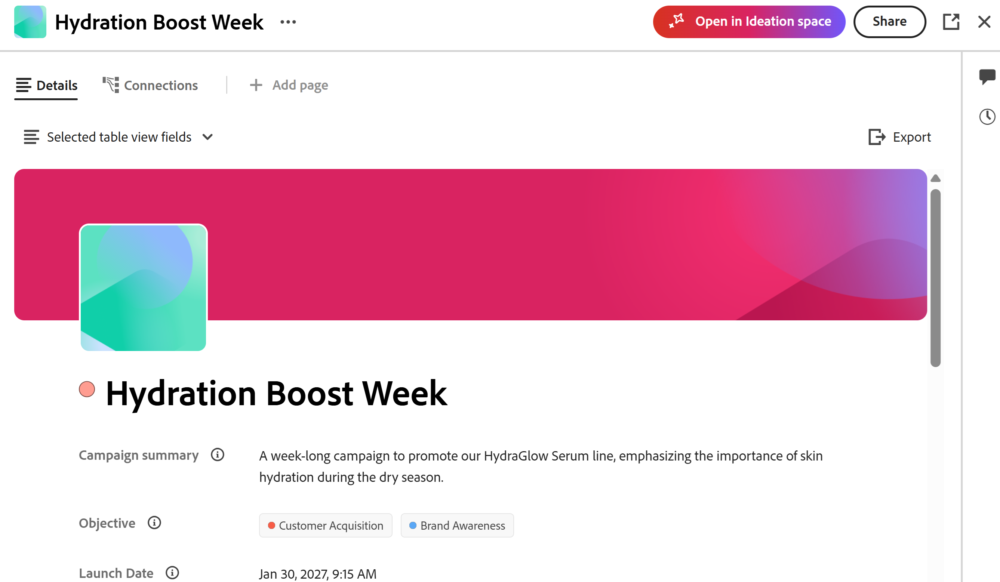
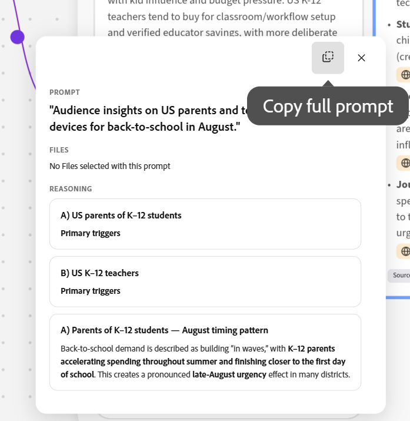

# Ideation 공간에 브리프 만들기

<!--add to TOC and miniTOC-->

이 페이지의 정보는 아직 일반적으로 사용할 수 없는 기능을 참조합니다. **관념화 공간 Beta** 프로그램의 일부로서만 사용할 수 있습니다. 

자세한 내용은 [Adobe Workfront Planning의 Ideation 공간 시작](/help/quicksilver/planning/ideation/get-started-with-planning-ideation.md)을 참조하십시오.

>[!IMPORTANT]
>
>이 문서의 정보는 Adobe Workfront Planning을 가지고 있는 Workfront 고객에게만 제공되는 기능을 나타냅니다. 회사에서 추가 Planning 패키지를 구매해야 합니다.
>
>여기에 설명된 기능은 조직이 Workfront Planning을 독립형 제품으로 구입한 경우에는 사용할 수 없습니다.
>
>Workfront Planning에 대한 일반적인 정보는 [Adobe Workfront Planning 시작](/help/quicksilver/planning/general/planning-overview.md)을 참조하십시오.
> 
>

<!--
Future - when they make it available in Planning: replace the above with this OR ... insert the snippet:

>[!IMPORTANT]
>
>The information in this article refers to Adobe Workfront Planning which your organization can purchase either as an Adobe Workfront package or a standalone product. 
>
>Not all capabilities included in the Planning package are available to Workfront Planning when it is purchased as a standalone product. 
>
>For general information about Workfront Planning, see [Get started with Adobe Workfront Planning](/help/quicksilver/planning/general/planning-overview.md).
> 
>For information about Workfront Planning as a standalone product, see [Get started with Adobe Workfront Planning as a standalone product](/help/quicksilver/planning/planning-sta/planning-sta-overview.md). 
>
-->

Adobe Workfront Planning의 새로운 기능인 Ideation Space를 사용하여 브리핑을 Planning 레코드로 변환하거나 외부 파일로 저장할 수 있습니다. 내보낸 브리프는 새 레코드를 만들거나 기존 레코드를 업데이트합니다.

이 문서에서는 Ideation 공간에서 브레인스토밍하고 전략하여 브리프를 만드는 방법에 대해 설명합니다.

다음을 수행할 수 있습니다.

* 레코드를 만들거나 업데이트하려면 완료된 관념화 브리핑을 Workfront Planning으로 내보냅니다.

* 다른 응용 프로그램에서 개요 정보를 사용하려면 다음 파일 형식 중 하나로 내보냅니다.

  * PDF
  * 단어
  * PowerPoint
  * PowerPoint 템플릿

## 액세스 요구 사항

+++ 을 확장하여 이 문서의 기능에 대한 액세스 요구 사항을 봅니다. 

<!--
are there additional license restrictions or packages to be purchased to have access to Ideation space?? If yes, update the table below
-->

<table style="table-layout:auto"> 
<col> 
</col> 
<col> 
</col> 
<tbody> 
    <tr> 
<tr> 
</tr> 
<tr> 
   <td role="rowheader">
클라우드 공급자 요구 사항
</td> 
   <td>
Amazon Web Services(AWS)

   
<b>참고:</b>

   
다른 클라우드 공급자는 지원되지 않습니다.

   </td> 
  </tr>
<tr> 
   <td role="rowheader">
Adobe Workfront 패키지
</td> 
   <td> 
<ul> 
<li>
Planning 패키지가 있는 모든 워크플로우
</li>
<!--
Add this at GA - not available in beta:
Or
<li>
Any Planning package when purchased as a standalone product
</li>
-->
</ul>
   </td> 
<!--
<tr> 
<td role="rowheader">
Additional products
</td> 
<td><ul>
<li>
Adobe GenStudio for Performance Marketing
</li>
<li>
Adobe Customer Journey Analytics
</li>
</ul>
</td> 
</tr> 
-->
<tr> 
   <td role="rowheader">
시스템 요구 사항
</td> 
   <td>
설정 영역의 시스템 환경 설정에서 동료 및 MCP 환경 설정 을 켜야 합니다.

   </td> 
  </tr> 
  <tr> 
   <td role="rowheader">
Adobe Workflow 라이선스
</td> 
   <td>
표준

   </td> 
  </tr> 
<tr> 
   <td role="rowheader">
Adobe Planning 라이선스
</td> 
   <td>
표준

   </td> 
  </tr>  
<tr> 
   <td role="rowheader">
액세스 수준 구성
</td> 
   <td> 
   <ul>
   <li>
액세스 수준에 워크플로 및 Planning 라이선스 유형을 모두 추가해야 합니다. <!--when you have both a Workflow and a Planning package-->
   </li>
   <li>
액세스 수준의 관념화 공간 사용 안 함 설정을 선택 해제해야 합니다.
</li>
   <li>
액세스 수준의 Workfront에서 CX Coworker 패널 비활성화 설정을 선택 취소해야 합니다
</li></ul>
</td> 
  </tr>  
   <tr> 
   <td role="rowheader">
개체 권한
</td> 
   <td> 
레코드를 추가할 작업 영역 및 레코드 유형에 대한 또는 그 이상의 사용 권한을 부여합니다. 

      
시스템 관리자는 만들지 않은 작업 영역을 포함하여 모든 작업 영역에 대한 권한을 가집니다

      <!--
      not available right now:
      
View permissions to Workfront objects to add them to briefs 

      -->
      
브리프를 만들 수 있는 편집 공간 권한

   </td> 
  </tr>  
    <!--
    <tr> 
    <td role="rowheader">
Adobe GenStudio for Performance Marketing user roles
</td> 
    <td>
<ul><li>Any GenStudio user role to access Campaigns, Products, and Personas</li>
    <li>GenStudio System Manager to access Activations and Events</li></ul>
    For information, see <a href="https://experienceleague.adobe.com/ko/docs/genstudio-for-performance-marketing/user-guide/intro/user-roles">User roles and permissions</a>. 
    

    </td> 
    </tr> 
    -->
</tbody> 
</table>

Workfront 액세스 요구 사항에 대한 자세한 내용은 Workfront 설명서의 [액세스 요구 사항](/help/quicksilver/administration-and-setup/add-users/access-levels-and-object-permissions/access-level-requirements-in-documentation.md)을 참조하십시오.

+++  

## 관념화 공간 개요 만들기

브리프를 생성하여 Planning 레코드를 생성 또는 편집하거나 다른 응용 프로그램으로 내보낼 수 있는 파일을 생성할 수 있습니다.

1. Coworker가 설정된 Planning으로 Workfront에 로그인하고 다음 중 하나를 수행하여 브리프를 처음으로 만들 수 있는 Ideation 공간을 엽니다.

   * **주 메뉴**  > **관념화 공간**(으)로 이동

     

   * **주 메뉴로 이동**  > **계획** > 작업 공간 클릭 > 레코드 유형 클릭 > **새 레코드 클릭** > **관념화 공간 시작**

     새 레코드의 

   * **주 메뉴로 이동**  > **계획** > 작업 공간 클릭 > 레코드 유형 클릭 > 기존 레코드 클릭 > **관념에서 열기**

     

1. Beta 계약을 읽고 **동의**&#x200B;를 클릭합니다. 관념화 공간을 사용하려면 계약서에 서명해야 합니다.

   관념화 공간 캔버스가 열리고 기본적으로 다음 형식 뒤에 새 관념의 제목이 지정됩니다.

   `catalyze-canvas-< number > - Month date, year at time` <!--submitted bug to change the default name to "Untitled ideation"-->

   Ideation Space를 사용하여 레코드를 만드는 방법에 대한 자세한 내용은 [Ideation Space Brief에서 계획 레코드 만들기](/help/quicksilver/planning/ideation/create-records-in-ideation-space-for-planning.md)를 참조하십시오.

1. (조건부) 관념화 공간에서 기존 개요를 열려면 Coworker가 설정된 Planning으로 Workfront에 로그인하고 다음 중 하나를 수행합니다.

   * **주 메뉴로 이동**  > **계획** > 작업 공간 클릭 > 레코드 유형 클릭 > 기존 레코드 클릭 > **관념에서 열기**

     관념화 이름은 레코드의 이름과 일치합니다.

1. (권장) 처음 연 경우에는 표의 이름을 클릭하여 이름을 변경합니다.

1. (조건부 및 선택 사항) 다른 기존 관념화 공간을 열려면 관념화 이름 오른쪽에 있는 드롭다운 메뉴를 클릭하고 이름별로 관념화를 검색한 다음 목록에 표시될 때 관념을 클릭합니다.

   **Ideation 공간**&#x200B;이 열리고 오른쪽에 Coworker가 열립니다.
1. Coworker 프롬프트를 사용하여 만들려는 개요 종류를 설명하십시오.

   예를 들어, &quot;미국의 부모와 교사를 위해 K-12 학생들이 8월 한 달 동안 진행할 등교 캠페인을 만들기&quot;를 입력합니다.  개요를 최대한 작성하려면 어떤 유형의 캠페인, 타임라인, 관련자, 승인 체크포인트 및 기타 세부 정보에 사용 가능한 한 많은 정보를 표시하십시오.
1. (선택 사항) Coworker 프롬프트 상자에서 **+** 아이콘을 클릭하고 다음과 같은 방법으로 정보를 첨부합니다.

   * **명령**: 목록에서 명령을 사용하여 Coworker에 내용을 입력하라는 메시지를 표시합니다.
   * **파일 첨부**: 프롬프트 상자에 파일을 첨부하여 이미지 캔버스에 파일이나 해당 정보를 추가합니다. 나중에 Coworker에게 파일을 기반으로 카드를 만들어 브리프로 보내도록 요청해야 합니다.
   * **개체 참조**: 목록에서 개체를 선택하여 아이디어에서 참조합니다. 개체가 Workfront에 있어야 합니다.

1. Enter를 클릭합니다.

1. Coworker의 질문에 답변하여 아이디어를 계속한 다음 **제출**&#x200B;을 클릭합니다

   또는

   추가 질문을 건너뛰려면 **질문서 건너뛰기**&#x200B;를 클릭하십시오.

1. (조건부) Coworker가 관념에 대한 카드 만들기를 제안하면 **예**&#x200B;라고 답합니다.

   카드가 관념화 캔버스에 추가되며 각 카드의 소스를 보고 개요에 추가할 항목을 결정할 수 있습니다.

   >[!TIP]
   >
   >파일을 개요에 바로 추가할 수 없습니다. 먼저 파일 정보를 설명서에 보낼 수 있는 카드로 전송해야 합니다.

1. **검색** 아이콘 을 클릭하여 관념화 캔버스에서 항목을 검색한 다음 목록에 표시될 때 클릭하여 탐색합니다.

1. (선택 사항) 모든 카드의 맨 아래에 있는 **소스**&#x200B;를 클릭하여 정보가 수집된 위치를 이해합니다.

   Workfront Planning 또는 웹에서 정보를 가져올 수 있습니다.

   또한 스페이스의 오른쪽 상단에 있는 **소스** 아이콘 을 클릭하여 스페이스의 모든 카드에 대한 소스 목록을 표시할 수도 있습니다.
1. (선택 사항) 스페이스의 오른쪽 상단에 있는 **댓글** 을 클릭하고 **@**&#x200B;을(를) 태깅하여 스페이스 내에서 브레인스토밍을 시작합니다.

   사용자는 태그에 대한 이메일 알림을 받게 됩니다.
1. (선택 사항) 댓글 카드 내의 **필터** 아이콘 을 클릭하여 다음 기준에 따라 댓글을 필터링합니다.

   * 검토자
   * 댓글이 추가된 시간
   * 상태(댓글이 해결되었거나 해결되지 않은 경우)
   * 읽지 않음(읽지 않은 의견만 표시)
1. (선택 사항) 카드에 있는 **엄지 위쪽** 또는 **엄지 아래쪽** 아이콘 을 사용하여 카드에 있는 정보의 정확성에 대한 피드백을 제공합니다.
1. 카드를 클릭하거나 모든 카드가 들어 있는 프레임을 클릭한 다음 **브리핑에 추가**&#x200B;를 클릭하여 해당 정보를 설명에 추가합니다.

   Workfront은 각 정보를 저장할 가능성이 가장 높은 필드와 일치시킵니다.

   예를 들어 타임라인은 날짜 유형 필드에 추가되고 설명은 단락 유형 필드에 추가됩니다.

1. (조건부) 카드를 클릭한 다음 **AI에게 묻기...**&#x200B;를 클릭하여 다음 단계에 대한 아이디어를 얻은 후 정보를 개요에 추가합니다. 답변은 각 카드의 정보 컨텍스트에 있습니다.
1. 관념화 캔버스의 왼쪽 위 모서리에 있는 **문서 추가** 아이콘 을 클릭하여 스페이스에 문서를 업로드하십시오. 새 문서나 이전에 이미 추가한 문서를 스페이스에 추가할 수 있습니다.

   >[!TIP]
   >
   >문서에 액세스하여 이를 스페이스에 업로드하려면 문서 설정을 켜야 합니다.
   >자세한 내용은 이 문서에서 [관념화 공간 캔버스 구성](#configure-the-ideation-space-canvas) 섹션을 참조하십시오.
   > 
1. **Workfront 연결된 계획 레코드 추가** 아이콘 를 클릭하고 연결된 레코드 유형을 선택한 다음 각 유형의 레코드를 선택하여 해당 레코드의 정보를 선택한 레코드 유형에 추가합니다.

   스페이스에 추가하기 위해 선택한 레코드에 대한 카드가 만들어집니다. 레코드 유형은 레코드 카드의 왼쪽 상단 모서리에 표시됩니다.

   >[!TIP]
   >
   >* **Workfront 연결된 계획 레코드 추가** 아이콘은 기본 메뉴에서 Ideation 공간에 액세스할 때 사용할 수 없으며 개요가 Planning 레코드에 연결되어 있지 않습니다.
   >
   >* 연결된 계획 레코드만 관념의 컨텍스트로 관념 공간 캔버스에 추가할 수 있습니다. 캔버스에 추가된 연결된 각 레코드 카드는 생성된 콘텐츠 유형에 영향을 주며 해당 컨텍스트는 관념화 중에 사용할 수 있습니다.
   >
   >   예를 들어 기존 레코드 유형을 활용해야 하는 캠페인을 작성하려면 해당 레코드를 캔버스에 추가합니다.

1. (선택 사항) 연결된 레코드 카드에서 **자세히** 메뉴 를 클릭하고 **Workfront에서 보기**&#x200B;를 클릭합니다.

   레코드의 세부 사항 페이지가 Workfront Planning의 다른 브라우저 탭에서 열립니다.
1. (선택 사항) 이미지 프레임 또는 카드를 선택하고 **삭제** 아이콘을 클릭한 다음, **삭제**&#x200B;를 클릭하여 확인합니다. 카드가 관념화 공간 캔버스에서 제거됩니다.

   저장된 문서나 레코드에 해당하는 카드를 삭제하면 항목이 캔버스에서 제거되지만 해당 응용 프로그램에는 남아 있습니다.

1. (선택 사항) 언제든지 오른쪽 아래 모서리에 있는 **Ask Coworker anything** 상자를 사용하여 아이디어를 구체화합니다.

   예를 들어 업데이트된 컨텍스트를 사용하여 특정 카드를 AI가 다시 실행하도록 하려면 `regenerate`을(를) 입력합니다. 관념화 공간은 추론 단계(검색, 합성, 인용)를 재실행하고 영향을 받는 카드를 업데이트합니다.

1. (선택 사항) IDEATION 카드 세트에서 자주색 커넥터 중 하나를 클릭한 다음, **전체 프롬프트 복사** 아이콘을 클릭하여 카드를 생성한 프롬프트를 클립보드에 복사한 다음 Coworker 프롬프트 상자에 붙여넣습니다.

   

1. (선택 사항) 작업을 취소하거나 취소하려면 캔버스 맨 위에 있는 **실행 취소** 또는 **다시 실행** 아이콘 을 클릭합니다.
1. 축소하여 전체 그림을 보십시오. 원래 캠페인 목표, 인용이 있는 모든 AI 생성 개념 카드, 추가 문서, 가져온 실제 Workfront Planning 레코드(제품, 가상 사용자 등). 왼쪽 아래 모서리에 있는 **Brief** 요약 카드는 모두 가져옵니다.

1. 왼쪽 하단의 간략한 미리 보기 이미지를 클릭하고 간략한 내용을 검토한 후 다음 옵션 중 하나를 클릭합니다.

   * **파일로 내보내기**. 개요를 다음 파일 형식으로 내보낼 수 있습니다.

     * PDF
     * 단어
     * PowerPoint(템플릿 포함 또는 제외)
   * **Workfront 계획으로 내보내기**. 내보내기는 해당 관념에 해당하는 Planning 레코드의 모든 기존 필드 데이터를 덮어씁니다.

   >[!TIP]
   >
   >기본 메뉴에서 Ideation 공간에 액세스할 때 **Workfront Planning으로 내보내기**&#x200B;가 흐리게 표시되고 개요가 Planning 레코드에 연결되어 있지 않습니다.

   그러면 추가 정보가 있는 레코드 또는 파일 작성이 완료됩니다. 기존 레코드에서 시작한 경우 브리프의 정보가 레코드에 추가됩니다. 새 레코드로 시작한 경우 개요에 나와 있는 정보로 레코드가 만들어집니다.

   Brief를 사용하여 Planning 레코드를 업데이트하는 방법에 대한 자세한 내용은 [Ideation Space Brief에서 Planning 레코드 만들기](/help/quicksilver/planning/ideation/create-records-in-ideation-space-for-planning.md) 문서의 &quot;ConsiderationsConsiderations: Ideation Space를 사용하여 레코드를 만드는 방법에 대한 고려 사항&quot; 섹션을 참조하십시오.
1. (선택 사항) **공유**&#x200B;를 클릭하여 다른 사용자와 관념화 캔버스를 공유합니다.

   자세한 내용은 [다른 사용자와 관념화 공간 공유](/help/quicksilver/planning/ideation/share-the-ideation-space.md)를 참조하십시오.

## 관념화 공간 캔버스 구성

관념화 공간에는 캔버스를 탐색하는 데 도움이 될 뿐만 아니라 화면에 표시되는 내용을 구성하는 컨트롤이 있습니다.

1. AI가 정보를 가져오는 위치를 제어하려면 **설정** 아이콘 을 클릭하고 다음 **Source 유형** 중에서 선택하십시오.

   * **문서** — 선택한 스페이스에 업로드된 문서
   * **웹 검색** — 외부 웹 조사
   <!--
     **CJA** — Adobe Customer Journey Analytics
    -->
1. **저장**&#x200B;을 클릭합니다.

1. **도움말** 아이콘  왼쪽에 있는 **확대/축소 수준** 드롭다운 메뉴를 클릭하여 옵션을 선택합니다.

   다음 선택 사항 중 하나를 선택합니다.

   * **크기에 맞게 확대/축소**
   * **확대**
   * **축소**
   * **50**, **100**, **150** 또는 **200%**&#x200B;로 확대/축소
   * **점 눈금 표시**: 점 눈금을 표시하려면 선택 항목을 설정합니다.
   * **제품 둘러보기**: Ideation 공간을 사용하는 동안 힌트 안내를 옵트아웃하려면 선택을 끕니다.

1. 캔버스를 탐색하거나 다른 확대/축소 값을 선택하는 데 사용할 수 있는 키보드 단축키를 검토하려면 **도움말** 아이콘 을 클릭하십시오.

| 작업 | 단축키 |
| --- | --- |
| 확대/축소 | Ctrl/⌘ + / − |
| 100%로 확대/축소 / | Ctrl/⌘ 1 / 1 |
| 200%로 확대/축소 / | Ctrl/⌘ 2 / 2 |
| 크기에 맞게 확대/축소 | Ctrl/⌘ 0 / 0 |
| 선택 영역에 맞게 확대/축소 | Alt Ctrl 0 |
| 커서로 확대/축소 | Ctrl/⌘ 스크롤 |
| 패닝 | 공간 끌기 |
| 점 격자 표시/숨기기 | G |

<!--

    Once opened, the Ideation space agent goes through the following steps:

    1. **Data ingestion and synthesis**:  Pulls relevant information from connected sources. For example: 
    
        * Existing record types or the existing record type that you started from. 
        * Recent documents you might have uploaded in the ideation space. 
        * Web information that matches your prompt criteria.

            >[!TIP]
            >
            >The Web search setting must be turned on for AI to be able to look for information on the web.  
            >For information, see the section [Configure the Ideation space](#configure-the-ideation-space)in this article.
            >
    1. **Audience definition**: Identifies or recommends target audience parameters based on historical patterns
    1. **Strategy framing**: Structures the strategic narrative for the campaign
    1. **Messaging and concept ideation**: Generates initial message options and creative concept directions
    1. **Brief generation and planning handoff**: Produces a structured brief that feeds back into the Workfront Planning workspace

        When the Ideation agent finishes the process of collecting all the information, the following things occur: 
    
        * Five cards are created and are organized by relevant and like-information. 

            The cards are titled using various steps in the creation of the requested record, for easy recognition. 
    
            For example, they could be named:

            * Plan
            * Timeline
            * Segments
            * Mechanics  
            * Messaging 

        The cards titles are custom to each card in the ideation. 

        * The cards are placed inside the same frame indicating this is the result of one ideation. 

        * A brief is created and displays in a preview image in the lower-left corner of the Ideation space. <!
    
        The brief contains suggested fields that the system considers pertinent to the ideas you are exploring. 
-->

