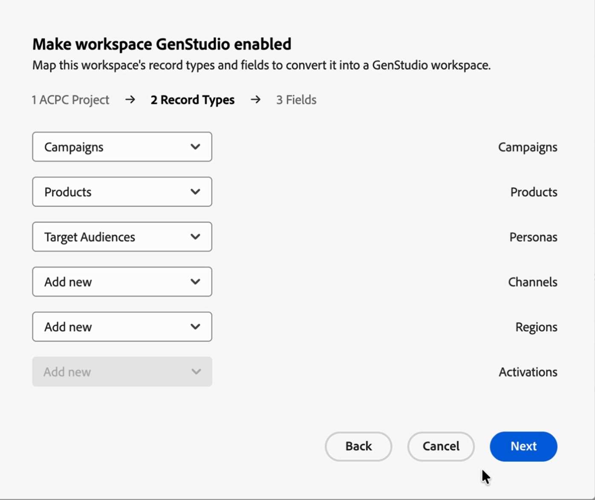

# GenStudio for Performance Marketing에 Workfront Planning 작업 영역 활성화

{{planning-important-intro}}

<!-- THIS IS HIDDEN FROM TOC-->

<!--Iskuhi said "ACPC projects" will be renamed when this will be released but not sure if it has been. Follow up with Syuzanna, Gurgen Mosesyan and possibly Himanshi Kumar - see slack threads -->

귀사에서 Adobe GenStudio for Performance Marketing도 구매하고 귀하가 Adobe Workfront Planning 고객인 경우 Workfront Planning에서도 GenStudio 작업 영역을 사용할 수 있습니다.

Workfront Planning에 이미 Planning 작업 영역이 있는 경우 GenStudio에서 동일한 데이터를 다시 만드는 대신 GenStudio for Performance Marketing에 대해 활성화할 수 있습니다.

작업 영역을 활성화하면 Adobe Can Storage 프로젝트에 연결되고 레코드 유형 및 필드를 GenStudio 작업 영역에 매핑됩니다. 구성을 완료한 후 GenStudio에서 작업 공간의 레코드를 열 수 있습니다.

다음 항목이 있어야 합니다.

* Workfront Planning 및 GenStudio for Performance Marketing 모두에 액세스할 수 있습니다.
* 작업 영역에 연결할 Adobe 클라우드 스토리지 프로젝트입니다. 조직 관리자는 Adobe Admin Console에서 만들 수 있습니다.

  자세한 내용은 [Adobe 저장소 관리](https://helpx.adobe.com/business/enterprise/manage-storage-assets/manage-storage/manage-adobe-storage.html)를 참조하십시오. <!--ensure this site still works-->

## 액세스 요구 사항

+++ 을 확장하여 이 문서의 기능에 대한 액세스 요구 사항을 봅니다. 

<table style="table-layout:auto"> 
<col> 
</col> 
<col> 
</col> 
<tbody> 
    <tr> 
<tr> 
</tr>   
<tr> 
   <td role="rowheader">
Adobe Workfront 패키지
</td> 
   <td> 

모든 Workfront 또는 워크플로 및 모든 Planning 패키지
 
또는

독립 실행형 제품으로 구입할 경우 모든 Planning 패키지

</td> 
   <tr> 
<td> 
   
 추가 제품
 </td> 
   <td> 
   
 Adobe GenStudio for Performance Marketing
</td> 
  </tr>

<tr> 
<td> 
   
 Adobe Admin Console 설정
 </td> 
   <td> 
   
 Adobe Admin Console에서 Adobe Storage Cloud 프로젝트를 만들어야 합니다 

자세한 내용은 <a href="https://helpx.adobe.com/business/enterprise/manage-storage-assets/manage-storage/projects-in-business-storage.html#project-policies">프로젝트 관리</a>를 참조하십시오.

</td> 
  </tr>
  <tr>

<tr> 
   <td role="rowheader">
Adobe Workfront 라이선스
</td> 
   <td>
워크플로우 표준

   </td> 
  </tr> 
  <tr> 
   <td role="rowheader">
Adobe Planning 라이선스
</td> 
   <td>
계획 수립 표준

   </td> 
  </tr>
<tr> 
   <td role="rowheader">
Adobe Workfront 액세스 수준 구성
</td> 
   <td> 
워크플로우와 Planning 패키지가 모두 있는 경우 Workfront 액세스 수준에 워크플로우와 Planning 라이선스 유형을 모두 추가해야 합니다.
   
</td> 
  </tr>

<tr> 
   <td role="rowheader">
Adobe GenStudio for Performance Marketing 사용자 역할
</td> 
   <td>
<ul><li>캠페인, 제품 및 가상 사용자에 액세스해야 하는 경우 모든 GenStudio 사용자 역할</li>
   <li>Activations에 액세스해야 하는 경우 GenStudio System Manager <!--and Events--></li></ul>
   자세한 내용은 <a href="https://experienceleague.adobe.com/en/docs/genstudio-for-performance-marketing/user-guide/intro/user-roles">사용자 역할 및 권한</a>을 참조하세요. 
   

  </td> 
  </tr>   
<tr> 
   <td role="rowheader">
개체 권한
</td> 
   <td>  
   
Workfront Planning에서: 

   <ul>
   <li>
작업 공간에 대한 권한 관리 <!--to add new fields or record types to the GenStudio workspace-->
</li>
   <!--
   <li>
Contribute permissions to the GenStudio workspace to add, update, or delete records in the GenStudio workspace
 </li>  
   -->
   </ul>
   <!--
   
No users can remove GenStudio for Performance Marketing record types or fields from the GenStudio workspace in Workfront Planning

   -->
   
Adobe GenStudio for Performance Marketing: 

   <ul>
   <!--
   <li>
 Any permissions in Adobe GenStudio for Performance Marketing
</li>
   -->
   <li>
 Adobe GenStudio for Performance Marketing에서 항목을 만들 수 있는 권한 만들기
</li></ul>
   </td>  
</tbody> 
</table>

Adobe Workfront Planning 액세스에 대한 자세한 내용은 [Adobe Workfront Planning 액세스 개요](/help/quicksilver/planning/access/access-overview.md)를 참조하십시오.

Adobe GenStudio for Performance Marketing에 대한 자세한 내용은 [Adobe GenStudio for Performance Marketing 사용 안내서](https://experienceleague.adobe.com/ko/docs/genstudio-for-performance-marketing/user-guide/home)를 참조하십시오.

+++ 

## GenStudio에 Workfront Planning 작업 영역 활성화

1. Workfront Planning에서 활성화할 작업 영역을 엽니다.
1. 작업 영역 이름 오른쪽에 있는 **기타** 메뉴 를 클릭한 다음 **GenStudio 사용**&#x200B;을 클릭합니다.

   **Make workspace GenStudio** enabled 상자가 다음 단계와 함께 열립니다.

   1. **ACPC 프로젝트**: 이 작업 영역과 동기화할 **ACPC 프로젝트**(Adobe Cloud Storage 프로젝트)를 선택한 후 **다음**&#x200B;을(를) 클릭합니다. 사용자는 이 프로젝트를 통해 GenStudio의 작업 영역에 액세스합니다.

      

   1. **레코드 종류**: 작업 영역의 레코드 종류를 GenStudio에 필요한 6개의 레코드 종류에 매핑합니다.

      * 캠페인
      * 제품
      * 페르소나
      * 채널
      * 지역
      * 활성화

      각 테이블에 대해 목록을 열고 일치하는 Planning 레코드 유형을 선택하거나 **새로 추가**&#x200B;를 선택하여 만든 후 **다음**&#x200B;을 클릭합니다.

      

   1. **필드**: 각 레코드 종류의 필드를 매핑합니다. 레코드 유형 간에 이동하려면 대화 상자 맨 위에 있는 탭을 사용합니다. 각 필드에 대해 일치하는 Planning 필드를 선택하거나 **새로 추가**&#x200B;를 선택하여 필드를 만듭니다.

      모든 레코드 유형에 대해 필드 설정을 반복합니다.

      

   1. 경고를 검토하고 해결하십시오.

      예를 들어 새 필드가 레코드 유형의 기본 필드가 되거나 이미 사용 중인 필드 별칭의 이름이 변경됩니다(이름이 &quot;지역&quot;인 필드가 이미 있는 경우 가져온 필드가 &quot;지역 2&quot;가 될 수 있음).

      **상태** 필드를 매핑하면 필수 옵션이 추가됩니다.

   1. **게시**&#x200B;를 클릭합니다.

      작업 영역이 활성화되면 확인 메시지가 나타납니다. 매핑된 레코드 유형은 작업 영역에 표시됩니다.

      GenStudio에서 액세스할 수 있도록 매핑된 레코드 형식의 카드에 새 **Adobe** 아이콘이 있습니다.

      

1. GenStudio을 열고 **캠페인**&#x200B;을 선택한 다음 화면 왼쪽 하단에서 이 설정에 대해 원래 구성한 **ACPC 프로젝트**&#x200B;를 클릭합니다. 가져온 레코드 종류 및 필드를 검토합니다.

   >[!TIP]
   >
   >Adobe 클라우드 스토리지 프로젝트 멤버십이 허용하는 레코드만 표시됩니다.
