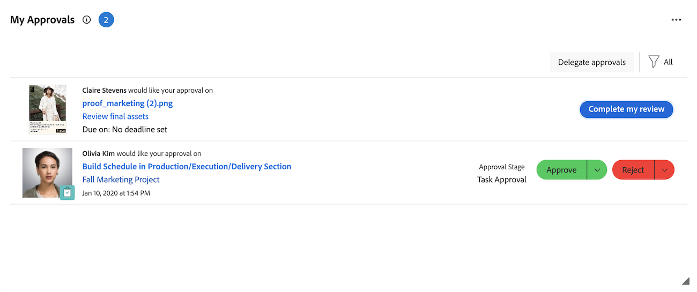

# 내 승인 위젯을 사용하여 승인 관리

내 승인 위젯에는 보류 중, 할당, 위임 및 제출된 모든 승인이 한 곳에 표시됩니다. 여기에서 승인을 필터링 및 구성하고 필요한 경우 결정을 내리고 승인을 위임할 수 있습니다.

내 승인 위젯은 다음 Workfront 오브젝트에서 승인을 지원합니다.

* 작업
* 문제
* 프로젝트
* 문서
* 교정쇄
* 레코드 요청 계획
* 타임시트

>[!NOTE]
>
>조직에서 Adobe 클라우드 스토리지를 사용하는 경우 문서가 포함된 프로젝트를 사용자와 공유할 때만 위젯에 문서 승인이 표시됩니다.

## 액세스 요구 사항

+++ 이 문서의 기능에 대한 액세스 요구 사항을 보려면 확장하십시오.

<table style="table-layout:auto"> 
 <col> 
 <col> 
 <tbody> 
  <tr> 
   <td role="rowheader">Adobe Workfront 패키지</td> 
   <td> 
Any
 </td> 
  </tr> 
  <tr> 
   <td role="rowheader">Adobe Workfront 라이선스</td> 
   <td> 
   
기여자 이상

   
검토 이상
 </td> 
  </tr> 
  <tr> 
   <td role="rowheader">액세스 수준 구성</td> 
   <td> 
승인과 연관된 객체에 대한 보기 이상의 액세스 권한
</td> 
  </tr> 
  <tr> 
   <td role="rowheader">개체 권한</td> 
   <td> 
승인과 연관된 오브젝트에 대한 이상 권한 보기
</td> 
  </tr> 
 </tbody> 
</table>

자세한 내용은 [Workfront 설명서의 액세스 요구 사항](/help/quicksilver/administration-and-setup/add-users/access-levels-and-object-permissions/access-level-requirements-in-documentation.md)을 참조하십시오.

+++

## 내 승인 위젯에서 작업 승인

1. 오른쪽 상단의 **[!UICONTROL 주 메뉴]** 을 클릭한 다음 **[!UICONTROL 홈]**&#x200B;을 클릭합니다.
1. (조건부) **사용자 지정**&#x200B;을 클릭하여 **내 승인** 위젯을 추가합니다.
1. (선택 사항) 내 승인 위젯에서 필터 옵션을 조정하여 표시할 승인을 선택합니다. 다음 필터 옵션을 사용할 수 있습니다.

   | 필터 옵션 | 설명 |
   |--------|-------------|
   | 모두 | 귀하에게 할당되고 다른 사용자가 귀하에게 위임하며 귀하가 제출한 모든 승인을 표시합니다. |
   | 내 승인 | 사용자에게 할당된 승인을 표시합니다. 기본 옵션입니다. |
   | 위임된 승인 | 다른 사용자가 귀하에게 위임한 승인을 표시합니다. |
   | 내가 제출한 승인 | 다른 사용자에게 제출한 승인을 표시합니다. |

   >[!NOTE]
   >
   >작업 역할 또는 그룹에 할당된 승인이 홈에 표시되지 않습니다. 팀에 할당된 승인은 각 팀 구성원의 내 승인 위젯에 표시됩니다.

1. (조건부) **정렬** 드롭다운 메뉴를 클릭한 다음 **가장 최근 항목 먼저**&#x200B;를 선택하여 가장 최근에 추가된 승인을 확인합니다.

1. (선택 사항) 전체 화면 아이콘 을 클릭하여 내 승인 위젯을 전체 화면으로 엽니다.

1. 승인 결정을 내릴 품목을 선택합니다.

   

   <!--update screenshot after production release-->

1. 오른쪽 패널에서 승인 결정을 내릴 때 사용할 수 있는 옵션 중 하나를 클릭합니다. 승인하는 항목의 유형에 따라 페이지의 오른쪽 상단에 다음 옵션이 표시됩니다.

   <table>
   <tr>
      <td>
      
<strong>액세스</strong>

      </td>
      <td>
      
<strong>작업 항목</strong>

      </td>
      <td>
      
<strong>문서</strong>

      </td>
      <td>
      
<strong>교정쇄</strong>

      </td>
   </tr>
   <tr>
      <td>
       <ul>
      <li>부여</li>
      <li>무시</li>
      </ul>
      원하는 경우 <b>액세스 변경</b> 드롭다운 메뉴에서 액세스 수준을 조정할 수 있습니다.
      </td>
      <td>
         <ul>
         <li>승인</li>
         <li>거부</li>
         </ul>
      결정 버튼의 드롭다운 메뉴를 클릭하여 결정과 함께 주석을 남길 수 있습니다.
      </td>
      <td>
   승인자로 할당됨
         <ul>
         <li>승인</li>
         <li>변경 사항과 함께 승인</li>
         <li>작업 필요</li>
         </ul>
   검토자로 할당됨
         <ul>
         <li>내 검토 완료</li>
         </ul>
      이 열의 옵션은 통합 승인에만 적용됩니다. 기존 문서 승인은 작업 항목 승인과 동일하게 표시됩니다. 
      </td>
      <td>
         <ul>
         <li>증명으로 이동</li>
         </ul>
         증명 뷰어에서 결정을 내립니다. 증명 검토에 대한 자세한 내용은 <a href="/help/quicksilver/review-and-approve-work/proofing/reviewing-proofs-within-workfront/review-proofs-in-wf.md">Adobe Workfront 내에서 증명 검토</a>를 참조하십시오.
      </td>
   </tr>
   </table>

## 위젯에서 승인이 제거되면

결정을 하면 내 승인 위젯에서 승인이 제거됩니다. 다음과 같은 경우에도 승인이 제거됩니다.

* **작업 승인**: 프로젝트가 다음 상태 중 하나에 있으면 위젯에서 프로젝트, 작업 및 문제에 대한 승인이 제거됩니다.
  * 완료
  * 중단
  * 보류 중

  >[!NOTE]
  >
  >프로젝트가 승인 보류 중인 경우 현재 승인자에 대해 프로젝트 자체 승인이 계속 표시될 수 있지만, 작업 및 문제에 대한 승인은 표시되지 않습니다.

* **기존 문서 승인**: 기존 문서 승인은 상위 개체가 아닌 문서가 직접 첨부된 개체의 상태에 따라 위젯에서 제거됩니다. 해당 오브젝트가 다음 상태 중 하나에 있으면 승인이 제거됩니다.
  * 프로젝트: 완료 또는 중단
  * 작업: 완료
  * 문제: 마감됨 또는 마감됨 과 동일한 상태. 해결됨, 해결되지 않음, 복제 불가 및 확인 완료 등이 여기에 포함됩니다.

* **통합 승인**: 통합 승인은 프로젝트, 작업 또는 문제 상태에 관계없이 위젯에 유지됩니다. 가시성은 승인 워크플로 및 승인 보류 중인 권한에 의해 제어되므로, 전체 워크플로가 완료되기 전에 위젯에서 승인을 제거할 수 있습니다.

사용자 지정 상태는 다음과 같음 매핑을 따르므로 위의 상태와 같은 상태가 되면 동일한 결과가 생성됩니다. 위젯에서 오브젝트가 제거되더라도 승인이 보류 중인 상태로 유지될 수 있습니다. 사용자 지정 상태에 대한 자세한 내용은 [상태 만들기 또는 편집](/help/quicksilver/administration-and-setup/customize-workfront/creating-custom-status-and-priority-labels/create-or-edit-a-status.md)을 참조하세요.
